---
puppeteer:
    pdf:
        format: A4
        displayHeaderFooter: true
        landscape: false
        scale: 0.8
        margin:
            top: 1.2cm
            right: 1cm
            bottom: 1cm
            left: 1cm
    image:
        quality: 100
        fullPage: false
---

OpenDID Wallet Admin Operation Guide
==

- Date: 2026-11-06
- Version: v3.0.0

Revision History
==
| Version | Date       | Changes |
| ------- | ---------- | ------- |
| v1.0.0  | 2025-03-31 | Initial release |
| v2.0.0  | 2025-05-29 | Version update |
| v3.0.0  | 2026-11-06 | Added API Log and Audit API Log guidance, retook the screen examples, and expanded chapter 3 with item tables aligned with the screens |


Table of Contents
==

- [OpenDID Wallet Admin Operation Guide](#opendid-wallet-admin-operation-guide)
- [Revision History](#revision-history)
- [Table of Contents](#table-of-contents)
- [1. Introduction](#1-introduction)
  - [1.1. Overview](#11-overview)
  - [1.2. Admin Console Definition](#12-admin-console-definition)
- [2. Basic Manual](#2-basic-manual)
  - [2.1. Login](#21-login)
  - [2.2. Main Screen Configuration](#22-main-screen-configuration)
  - [2.3. Menu Configuration](#23-menu-configuration)
    - [2.3.1. Wallet Unregistered State](#231-wallet-unregistered-state)
    - [2.3.2. Wallet Registered State](#232-wallet-registered-state)
  - [2.4. Password Change Management](#24-password-change-management)
- [3. Feature-Specific Detailed Manual](#3-feature-specific-detailed-manual)
  - [3.1. Wallet Service Registration](#31-wallet-service-registration)
    - [3.1.1. Step 1 – Enter Wallet Service Info](#311-step-1--enter-wallet-service-info)
    - [3.1.2. Step 2 – Register DID Document](#312-step-2--register-did-document)
    - [3.1.3. Step 3 – Register Entity and Issue Certificate VC](#313-step-3--register-entity-and-issue-certificate-vc)
    - [3.1.4. Registration Completion Screen](#314-registration-completion-screen)
  - [3.2. Wallet Service Management](#32-wallet-service-management)
  - [3.3. User Wallet Management](#33-user-wallet-management)
    - [3.3.1. User Wallet List](#331-user-wallet-list)
    - [3.3.2. User Wallet Details](#332-user-wallet-details)
  - [3.4. Admin Management](#34-admin-management)
    - [3.4.1. Admin List](#341-admin-list)
    - [3.4.2. Admin Registration](#342-admin-registration)
  - [3.5. Log Management](#35-log-management)
    - [3.5.1. API Log](#351-api-log)
    - [3.5.2. Audit API Log](#352-audit-api-log)
  - [3.6. Server Configuration](#36-server-configuration)
  - [3.7. Password Policy Settings](#37-password-policy-settings)
---

# 1. Introduction

## 1.1. Overview

This document provides guidance on the installation and operation of the Open DID Wallet Admin Console.
It is organized to explain everything from basic usage to detailed manuals for each function step by step, enabling users to efficiently utilize the console.

For a comprehensive guide on OpenDID installation, please refer to the [Open DID Installation Guide].

## 1.2. Admin Console Definition

**Wallet Admin Console** is a web-based administrator tool for managing **Wallet servers** within the Open DID system.

Wallet provides user-registered Wallet management functionality.

The main items that can be configured in the Wallet Admin Console are as follows:

- **User Wallet Management**
  - View user-registered Wallets
- **Log Management**
  - View Wallet Agent API calls and administrator activity
- **Server Configuration**
  - Set API keys for external server integration
- **Admin Management**
  - Manage administrator accounts and the password policy

# 2. Basic Manual

This chapter provides guidance on the basic usage of the Open DID Wallet Admin Console.

## 2.1. Login

To access the Wallet Admin Console, follow these steps:

1. Open a web browser and access the Wallet Admin Console URL.

   ```
   http://<wallet_domain>:<port>
   ```

2. Enter the administrator account email and password on the login screen.
   - Default administrator account: <admin@opendid.omnione.net>
   - Initial password: password (ID and password change required on first login)

3. Click the 'Login' button.

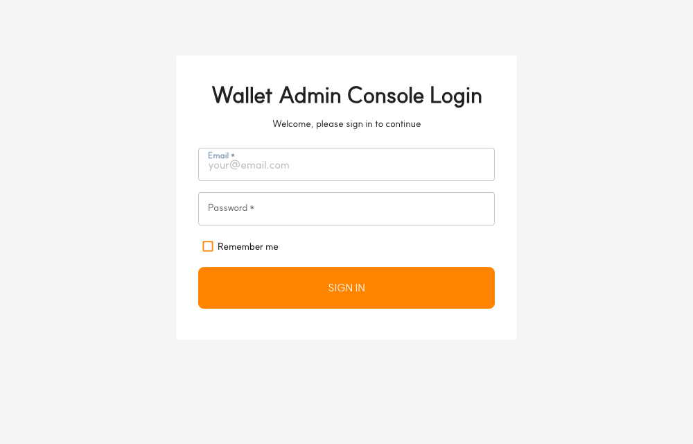

> **Note**:  
> For security reasons, the default administrator account must change its ID and password on first login.

<br/>

## 2.2. Main Screen Configuration

The main screen displayed after login consists of the following elements:

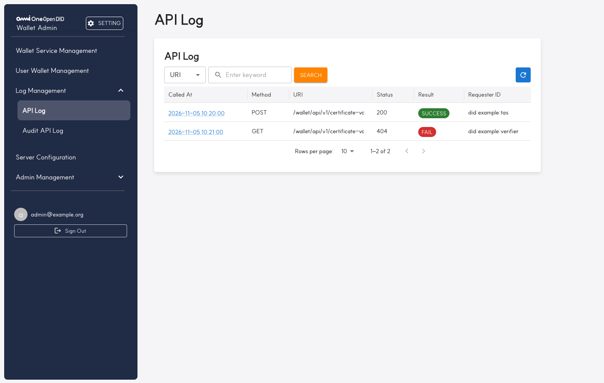

> Screen rendered with example data.

| No. | Area | Description |
| --- | ---- | ----------- |
| 1 | Header Area | You can navigate to the password change screen through the `SETTING` button in the upper right corner. |
| 2 | Content Area | The title of the currently selected menu and its corresponding content are displayed. Screen content changes according to each menu. |
| 3 | Side Menu | Located on the left side of the screen, with main menu items arranged vertically. The selected menu is highlighted, and sub-menus expand when necessary. |
| 4 | User Info Area | The email address of the currently logged-in administrator and the 'Sign Out' button are displayed. |


<br/>


## 2.3. Menu Configuration

The sidebar menu of the Wallet Admin Console **differs in screen configuration depending on the Wallet registration status**.


<br/>

### 2.3.1. Wallet Unregistered State

In the initial state where the Wallet server has not yet been registered,
only the Wallet Service Registration item is displayed alone in the menu.

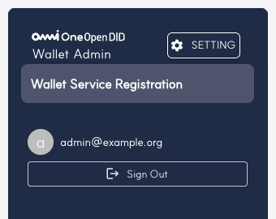

> Note: Once Wallet registration is completed, related functions are activated and the full menu expands.
> Details about the menu configuration after registration are explained in subsequent sections.

### 2.3.2. Wallet Registered State

Once Wallet registration is completed, all management functions are activated, and the sidebar menu is configured as follows:

| No. | Menu Name | Depth | Description |
|-----|-----------|-------|-------------|
| 1 | **Wallet Service Management** | 1 | Menu for viewing and managing basic information (DID, status, etc.) of the Wallet server. |
| 2 | **User Wallet Management** | 1 | Menu for viewing and managing user-registered Wallets. |
| 3 | **Log Management** | 1 | Parent menu for API Log and Audit API Log. |
| 4 | └ API Log | 2 | View Wallet Agent API calls. |
| 5 | └ Audit API Log | 2 | View administrator API activity. |
| 6 | **Server Configuration** | 1 | Manage external server integration settings. |
| 7 | **Admin Management** | 1 | Parent menu for administrator settings. |
| 8 | └ Admin Management | 2 | Manage administrator accounts. |
| 9 | └ Password Policy Settings | 2 | Set the administrator password policy. |

> **Note**:  
> Detailed usage instructions for each function in the above menu configuration are explained in numerical order in [Chapter 3. Feature-Specific Detailed Manual](#3-feature-specific-detailed-manual).
<br/>

## 2.4. Password Change Management

User password change can be performed through the following steps:

1. Click the 'SETTING' button in the header area.
2. Select 'Password Change' from the settings menu.
3. On the password change screen:
   - Enter current password
   - Enter new password
   - Enter new password confirmation
4. Click the 'Save' button to apply changes.

> **Note**: See [Password Policy Settings](#37-password-policy-settings) for the minimum length, expiration period, and composition rules that apply.

<br/>

# 3. Feature-Specific Detailed Manual

> Screens were captured with example data. Actual data varies by environment.

This chapter provides detailed usage instructions for the main functions of the Wallet Admin Console.

## 3.1. Wallet Service Registration

Wallet Service Registration registers the Wallet service in the OpenDID network. It has three steps.

<br/>

### 3.1.1. Step 1 – Enter Wallet Service Info

Enter the name and server URL of the Wallet service.

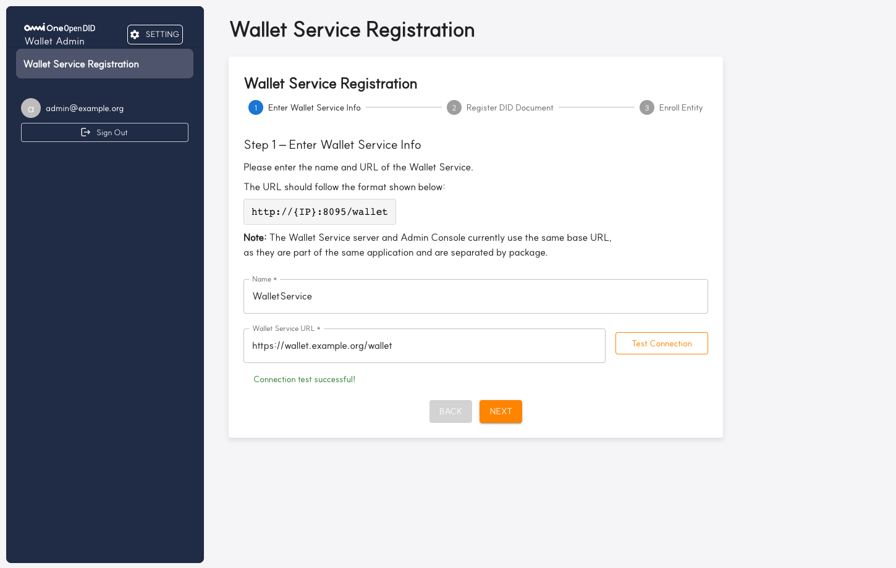

| No. | Item | Description |
| --- | --- | --- |
| 1 | **Name*** | Name of the Wallet service to register. Use 3 to 20 English characters. Example: `WalletService` |
| 2 | **Wallet Service URL*** | Wallet server address (up to 200 characters). Format: `http://{{IP}}:8095/wallet`. Example on the screen: `https://wallet.example.org/wallet` |
| 3 | **TEST CONNECTION Button** | Tests the connection to the entered URL. |
| 4 | **NEXT Button** | Saves the information and moves to the next step. |

> **Note**: The Wallet service server and the Admin Console use the same base URL and are separated by package internally.

<br/>

### 3.1.2. Step 2 – Register DID Document

Generate the DID Document of the Wallet service, request its registration from the TA, and check the TA administrator's approval.

**1. Generate DID Document**

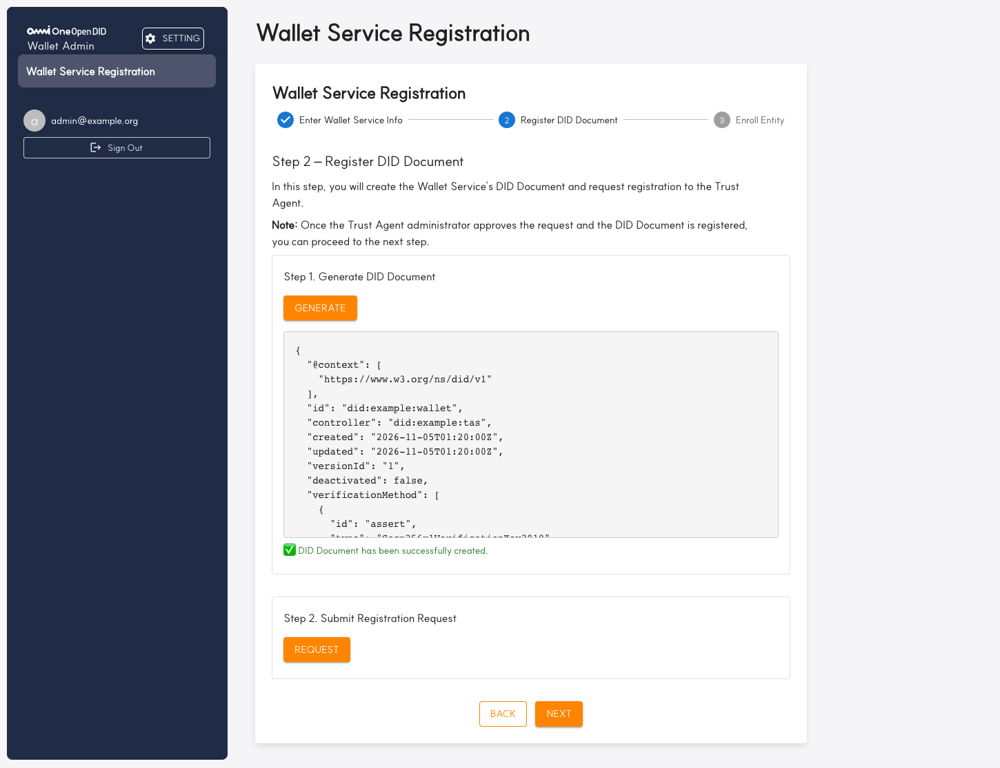

Click `GENERATE` to create the DID Document, which is shown as JSON on the screen. The completion message is `DID Document has been successfully created.`

**2. Submit Registration Request**

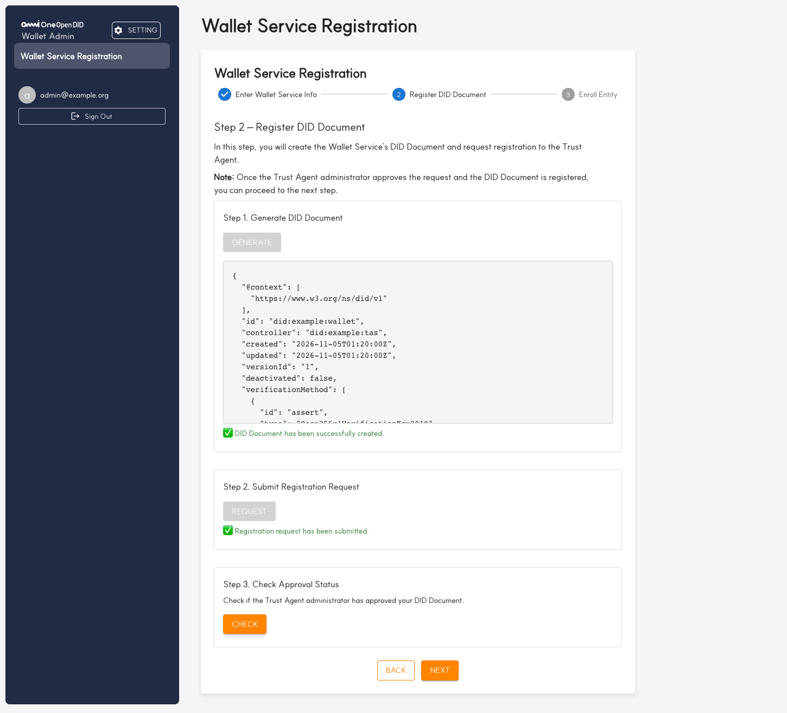

Click `REQUEST` to request DID Document registration from the TA. The completion message is `Registration request has been submitted.` The TA administrator approves the request on the Entity detail screen of the TA Admin Console.

**3. Check Approval Status**

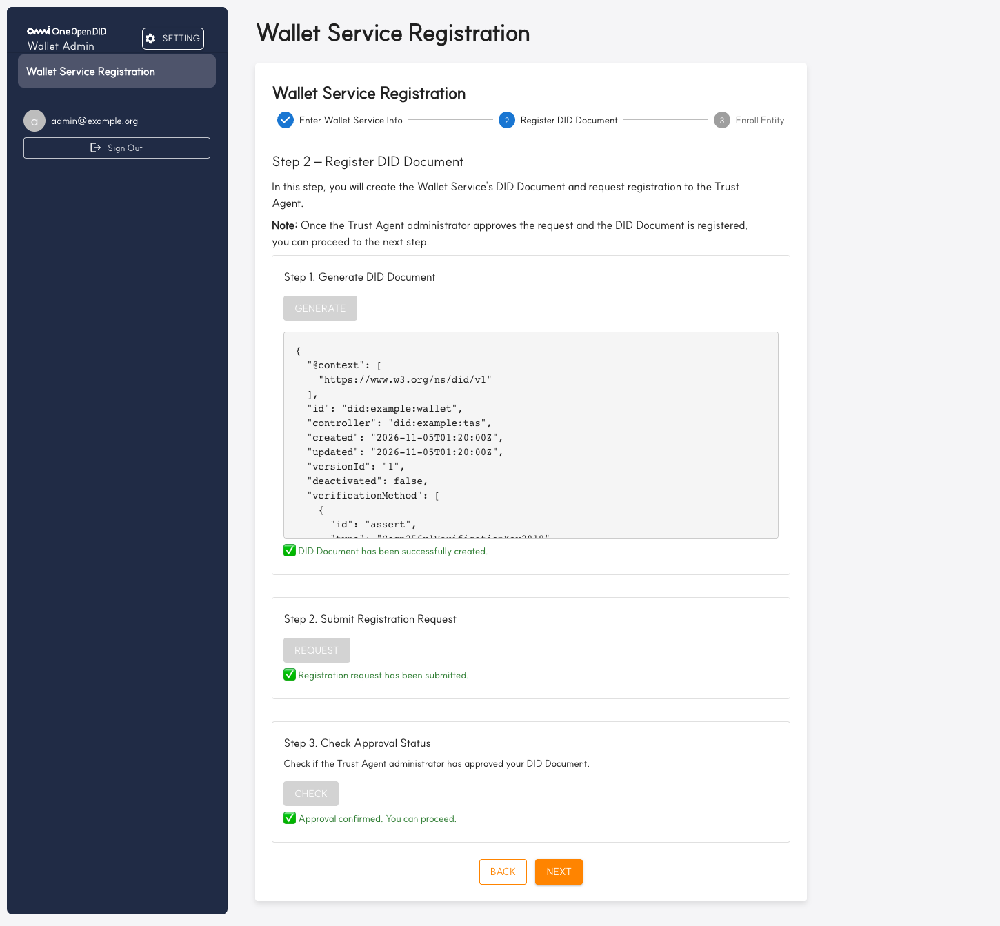

Click `CHECK` to check whether the request was approved.

| State | Message | Action |
| --- | --- | --- |
| Pending | `The DID Document registration request is still pending approval.` | Check again after approval. |
| Approved | `Approval confirmed. You can proceed.` | Click `NEXT` to move to the next step. |
| Rejected | `The DID Document registration request has been rejected.` | Returns to the first screen. |

<br/>

### 3.1.3. Step 3 – Register Entity and Issue Certificate VC

Register the Wallet service as an Entity and receive its certificate VC.

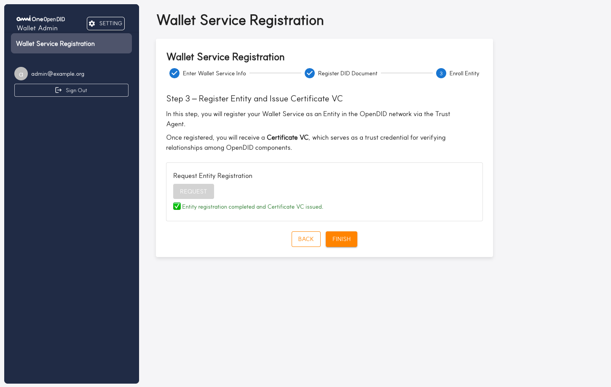

| No. | Item | Description |
| --- | --- | --- |
| 1 | **REQUEST Button** | Requests Entity registration from the TA. The certificate VC is issued when it completes. |
| 2 | **BACK Button** | Moves to the previous step. |
| 3 | **FINISH Button** | Finishes registration and opens the completion screen. |

> **Note**: The certificate VC is a credential that proves the trust relationship between OpenDID components.

<br/>

### 3.1.4. Registration Completion Screen

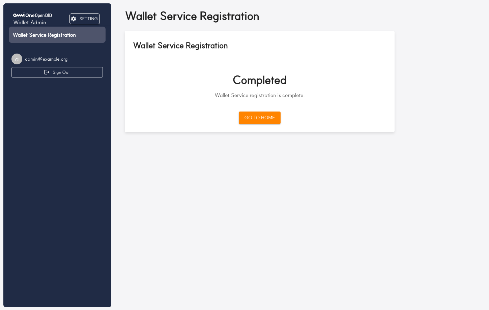

The `Completed` message is shown. Click `GO TO HOME` to open the Admin Console main screen.

<br/>

## 3.2. Wallet Service Management

This screen shows the information of the registered Wallet service. It has no function for editing or deleting the registration.

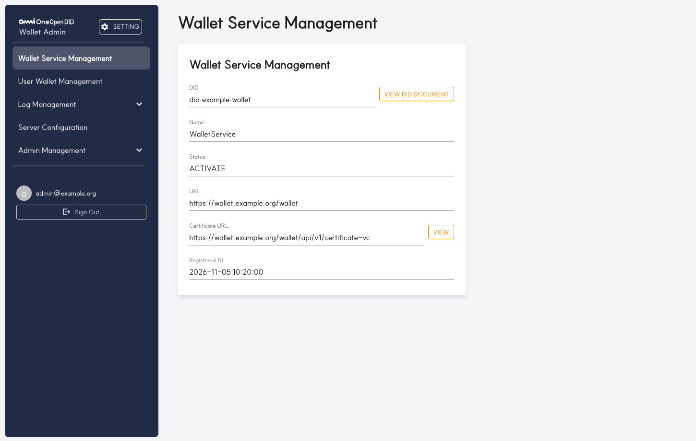

| No. | Item | Description |
| --- | --- | --- |
| 1 | **DID** | DID that identifies the Wallet service. |
| 2 | **VIEW DID DOCUMENT Button** | Shows the DID Document in a popup. |
| 3 | **Name** | Name of the Wallet service. |
| 4 | **Status** | Registration status. <br/>- `DID_DOCUMENT_REQUIRED`: DID Document not registered yet<br/>- `DID_DOCUMENT_REQUESTED`: Requested and waiting for approval<br/>- `CERTIFICATE_VC_REQUIRED`: Approved, certificate VC not issued yet<br/>- `ACTIVATE`: Registration complete<br/>- `DEACTIVATE`: Inactive |
| 5 | **URL** | Base URL of the Wallet server. |
| 6 | **Certificate URL** | URL where the certificate VC can be checked. |
| 7 | **VIEW Button** | Button next to Certificate URL. Shows the certificate VC issued by the TA in a popup. |
| 8 | **Registered At** | Date and time of first registration. |

<br/>

## 3.3. User Wallet Management

This menu shows the Wallets registered by users.

<br/>

### 3.3.1. User Wallet List

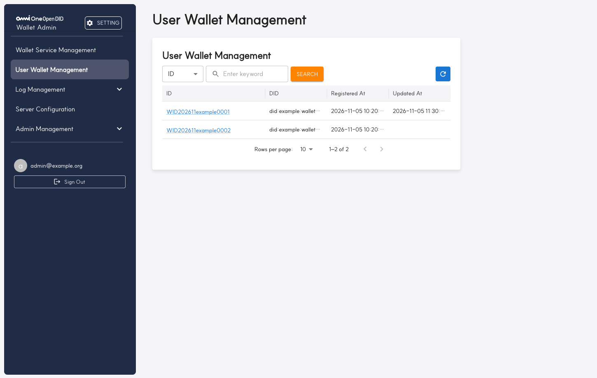

| No. | Item | Description |
| --- | --- | --- |
| 1 | **Search** | Searches by ID or DID. |
| 2 | **ID** | Wallet identifier. Click to open the detail screen. |
| 3 | **DID** | DID of the Wallet. |
| 4 | **Registered At** | Date and time the Wallet was registered. |
| 5 | **Updated At** | Date and time the Wallet was updated. |

<br/>

### 3.3.2. User Wallet Details

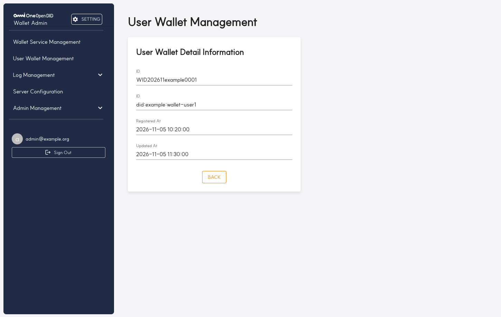

| No. | Item | Description |
| --- | --- | --- |
| 1 | **ID** | Wallet identifier. |
| 2 | **ID (second item)** | DID of the Wallet. The screen labels this item `ID`. |
| 3 | **Registered At** | Date and time the Wallet was registered. |
| 4 | **Updated At** | Date and time the Wallet was updated. |
| 5 | **BACK Button** | Returns to the list. |

<br/>

## 3.4. Admin Management

The `Admin Management` menu manages the administrator accounts that can access the Wallet Admin Console.

When the Wallet server is installed, the `admin@opendid.omnione.net` account is created automatically with ROOT permission. It is the only ROOT account in the system and cannot be deleted.

Administrator accounts have two permission types: **ROOT** and **Normal Admin**.

> **Note**: Currently, the only difference between ROOT and Normal Admin is the buttons shown in the `Admin Management` menu (only ROOT can use `REGISTER`, `DELETE`, and `CHANGE PASSWORD`). Access to other menus is not restricted yet.

<br/>

### 3.4.1. Admin List

The `Admin Management` menu shows the list of registered administrator accounts.

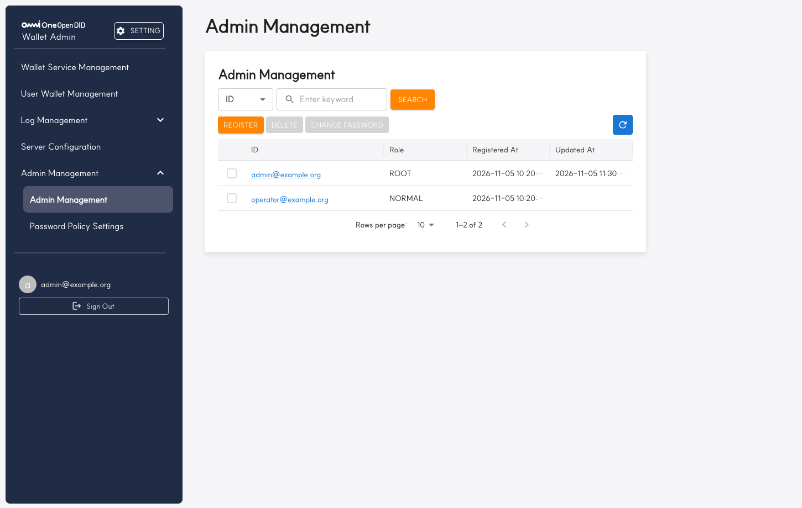

| No. | Item | Description |
| --- | --- | --- |
| 1 | **Search** | Searches by ID or Role (Root, Normal). |
| 2 | **REGISTER Button** | Opens the screen for registering a new administrator account. |
| 3 | **DELETE Button** | Deletes the selected administrator account. Only ROOT can do this. |
| 4 | **CHANGE PASSWORD Button** | Changes the password of the selected administrator account. |
| 5 | **ID** | Email ID of the administrator account. |
| 6 | **Role** | Permission of the administrator account. |
| 7 | **Registered At** | Date and time the account was registered. |
| 8 | **Updated At** | Date and time of the last modification. |

<br/>

### 3.4.2. Admin Registration

Click `REGISTER` to open the registration screen.

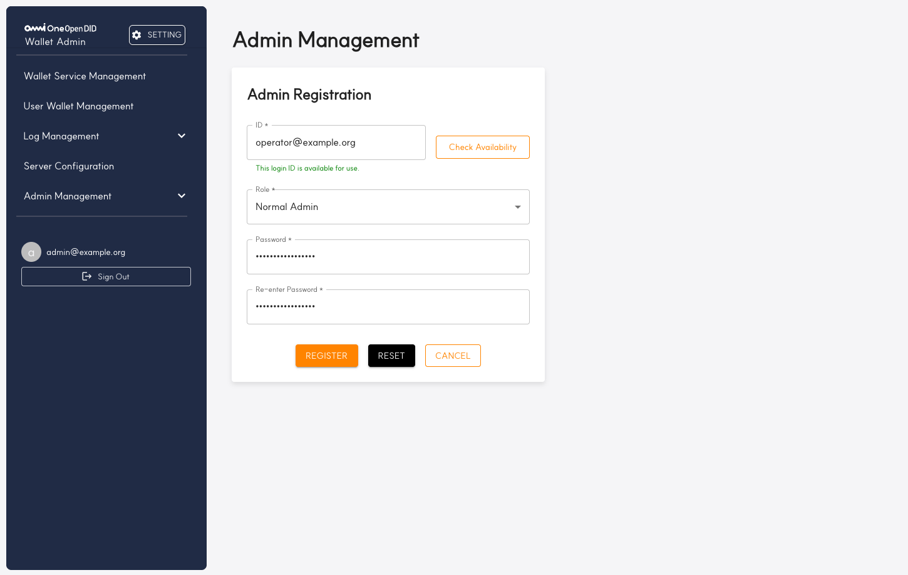

| No. | Item | Description |
| --- | --- | --- |
| 1 | **ID*** | ID of the administrator account. Use an email address of 3 to 30 characters. Example: `operator@example.org` |
| 2 | **Check Availability Button** | Checks that the ID is not already in use. The check must pass before registering. |
| 3 | **Role** | Select the permission of the account. Example: `Normal Admin` |
| 4 | **Password*** | Password used to sign in (8 to 30 characters). If the password policy is on, its rules also apply. |
| 5 | **Re-enter Password*** | Enter the password again. |
| 6 | **REGISTER Button** | Registers the administrator account with the entered information. |
| 7 | **RESET Button** | Resets the input. |
| 8 | **CANCEL Button** | Cancels and returns to the previous screen. |

<br/>

## 3.5. Log Management

Once Wallet is registered, API call records are available under `Log Management` in the sidebar. Both screens show the newest records first, page by page, and the refresh button reloads the list. Click `Called At` to open the detail dialog. Logs are read-only.

<br/>

### 3.5.1. API Log

`Log Management > API Log` (`/logs/api`) shows Wallet Agent API calls.


| No. | Item | Description |
| --- | --- | --- |
| 1 | **Search** | Searches by `URI` or `Result` (`SUCCESS`, `FAIL`). |
| 2 | **Called At** | Date and time of the call. Click to open the detail dialog. |
| 3 | **Method** | HTTP method. |
| 4 | **URI** | Called URI. |
| 5 | **Status** | HTTP status code. |
| 6 | **Result** | `SUCCESS` or `FAIL`. |
| 7 | **Requester ID** | Requester ID. |

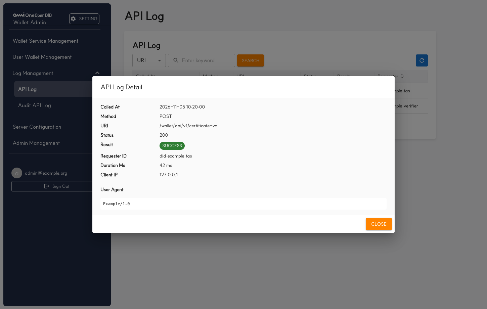

In addition to the list items, the detail dialog shows the following.

| Item | Description |
| --- | --- |
| **Duration Ms** | Processing time in milliseconds. |
| **Client IP** | Client IP address. |
| **User Agent** | User Agent of the request. |
| **Message** | Shown when an error message was recorded. |

<br/>

### 3.5.2. Audit API Log

`Log Management > Audit API Log` (`/logs/audit`) shows administrator operations performed through Admin APIs.

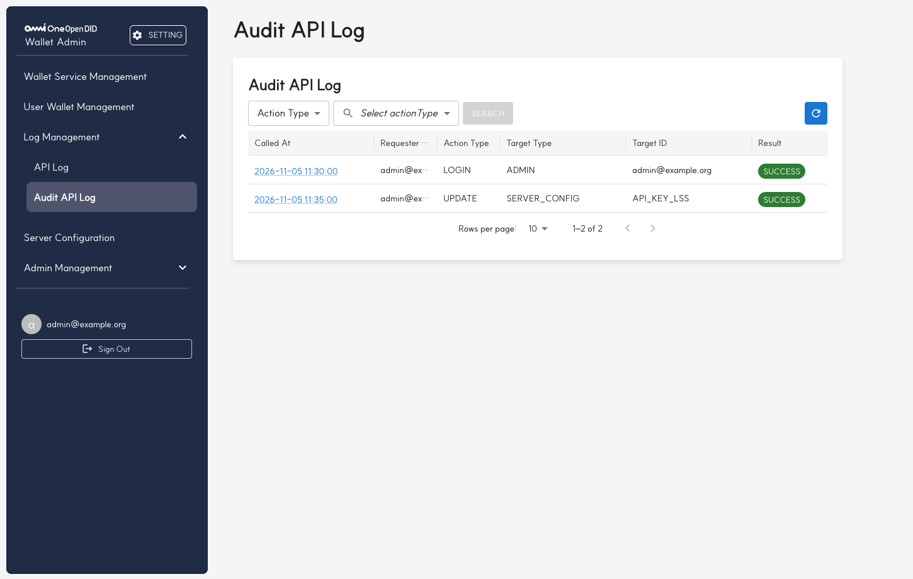

| No. | Item | Description |
| --- | --- | --- |
| 1 | **Search** | Searches by `Action Type`, `Target Type`, `Result`, or `Requester ID`. `Action Type` is selected from `NONE`, `CREATE`, `UPDATE`, `DELETE`, `LOGIN`, and `LOGOUT`. |
| 2 | **Called At** | Date and time of the call. Click to open the detail dialog. |
| 3 | **Requester ID** | ID of the administrator who performed the operation. |
| 4 | **Action Type** | Operation type. |
| 5 | **Target Type** | Type of the target. |
| 6 | **Target ID** | ID of the target. |
| 7 | **Result** | `SUCCESS` or `FAIL`. |

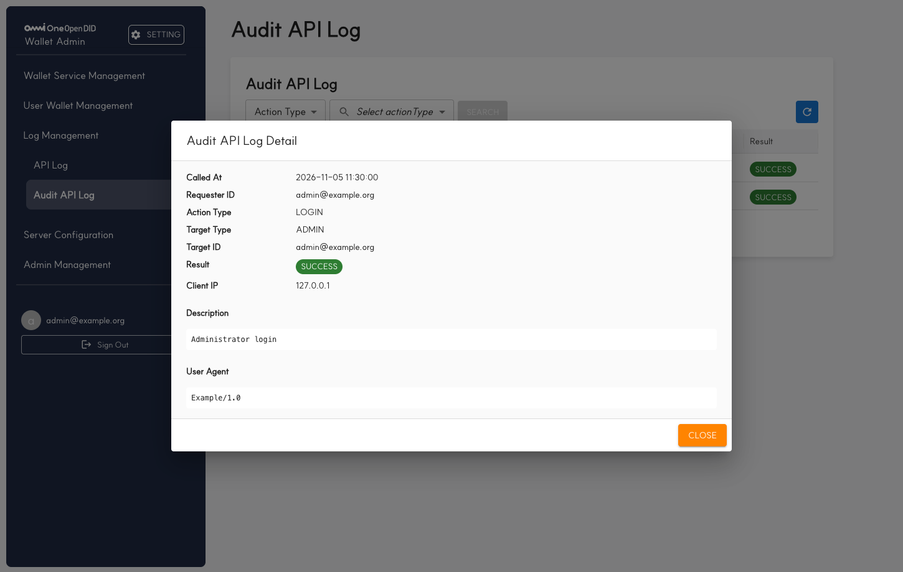

In addition to the list items, the detail dialog shows the following.

| Item | Description |
| --- | --- |
| **Client IP** | Client IP address. |
| **Description** | Description of the operation. |
| **User Agent** | User Agent of the request. |
| **Message** | Shown when an error message was recorded. |

> Logs are created from API calls that use `@ArticleLog` on the server. If the result is `FAIL`, check the status code in API Log and the detail message of that log.

## 3.6. Server Configuration

`Server Configuration` sets API keys for integrating with external servers.

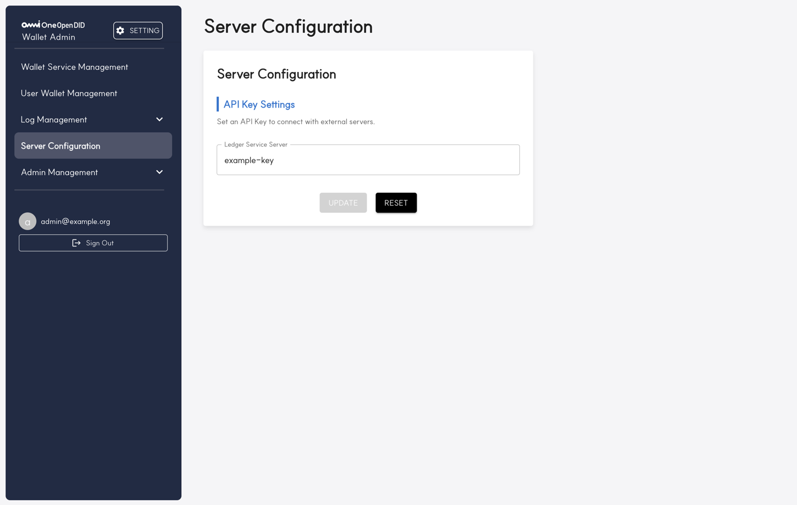

| No. | Item | Description |
| --- | --- | --- |
| 1 | **Ledger Service Server** | Enter the API key issued by LSS. It is stored as `API_KEY_LSS`, and the Wallet server sends it in the `X-API-Key` header when calling LSS (`lss` profile). |
| 2 | **UPDATE Button** | Saves the entered value. |
| 3 | **RESET Button** | Resets the input before saving. |

If no key is registered, LSS calls fail with `SSRVWLT01101`.

> **Caution**: Do not include API key values in screen captures, documents, or sample settings.

## 3.7. Password Policy Settings

`Admin Management > Password Policy Settings` sets the password rules for administrators. The rules apply when an account is registered and when a password is changed.

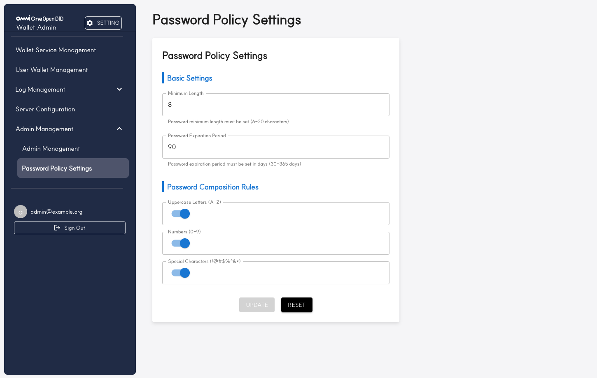

| No. | Item | Description |
| --- | --- | --- |
| 1 | **Minimum Length** | Minimum password length, from 6 to 20 characters. The default is 8. |
| 2 | **Password Expiration Period** | Password expiration period, from 30 to 365 days. The default is 90. |
| 3 | **Uppercase Letters (A-Z)** | Requires at least one uppercase letter. Off by default. |
| 4 | **Numbers (0-9)** | Requires at least one number. Off by default. |
| 5 | **Special Characters (!@#$%^&*)** | Requires at least one special character. Off by default. |
| 6 | **UPDATE Button** | Saves the policy. If no policy is registered yet, the button is named `REGISTER`. |
| 7 | **RESET Button** | Reverts to the input before the change. |

[Open DID Installation Guide]: https://github.com/OmniOneID/did-release/blob/main/release-V2.0.0.0/OpenDID_Installation_Guide-V2.0.0.0.md
